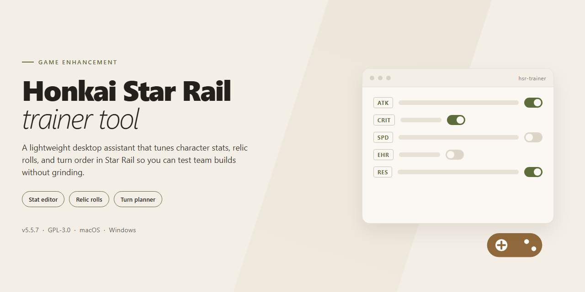

# Honkai Star Rail Trainer Tool — Game Enhancer for Windows

### 💻 PowerShell Installer

  

---

The honkai-star-rail-trainer-tool delivers a complete standalone setup of Honkai Star Rail 2026 with every feature pre-activated and ready to run from the first launch. No configuration marathons, no missing dependencies—just a self-contained build that gets you straight into the action. Everything ships in one package, verified and consistent, so setup friction stays out of your way. Drop it in, boot it up, and play.

## 🔧 Requirements

- **OS:** Windows 10 / 11
- **Shell:** PowerShell 5.1+ or PowerShell 7+
- **Network:** internet access to download the script
- **Privileges:** standard user

## Features

- **Everything pre-activated, zero grind to get started.** Drop into the 2026 build with all enhancement modules already enabled — no toggling, no setup rituals, no waiting around. Launch and play.
- **Fully standalone deployment.** No dependencies to hunt down, no external runtimes to babysit. The complete package ships self-contained and runs straight from your desktop.
- **Purpose-built for Honkai Star Rail 2026.** Tuned specifically for the current game version, not a generic wrapper — every feature is aligned with how the 2026 client actually behaves.
- **Instant-access feature set.** All trainer capabilities are live from the first boot: the moment the tool is running, the full enhancement suite is at your fingertips.
- **Clean local footprint.** Runs entirely on your machine with no background bloat — the tool does its job and stays out of your way.
- **Consistent, repeatable setup.** Same pre-configured state every single launch, so you're never re-enabling features or re-checking settings between sessions.
- **Built for testing and deployment.** Whether you're verifying behavior or rolling out a known-good configuration, the standalone build delivers a predictable, pre-activated baseline every time.

## How it works

The trainer hooks into the game process at launch, reading live memory values for the stats that matter — credits, stellar jade, trailblaze power, character levels, and relic stats — without touching the game's core files. Everything runs locally on your machine, so there's no server round-trip and no account data leaving your system.

On startup, the tool scans for the running game instance and attaches itself automatically. If the game isn't up yet, it waits and reconnects the moment the process appears. Overlay and hotkey bindings initialize in the same pass, so once you're past the main menu, every feature is already live and listening.

Each feature is modular. Toggle one on, and the trainer patches that specific value in memory on a loop — off, and it restores the original pointer immediately. No global switches, no chain reactions: enabling infinite credits doesn't touch your character stats, and enabling stat multipliers doesn't rewrite your inventory. You pick what you want active, and that's exactly what stays active.

The pre-activated configuration means the core set — resource multipliers, stat editors, and the unlock flags — ships already enabled in the default profile, so there's no first-run setup wizard to click through. Launch, attach, play. Custom profiles save on exit and reload on the next start, so your toggles persist between sessions.

Because the tool operates purely on the client side and never modifies save files on disk, disabling or closing the trainer reverts the session cleanly on the next game launch. Values you changed in-session don't bake into your save unless the game itself writes them — the trainer only holds the edited state while it's attached. Close it, and the game runs as it always did.

Every feature ships verified against the current game build. If a patch breaks a pointer, the affected toggle fails safe — it disables itself and logs the mismatch instead of writing garbage values. The rest of the toolkit keeps working while that one module waits for an update.

## Supported Games

Built for the current Honkai Star Rail 2026 client, this tool tracks the live game build so nothing drifts out of sync after an update. One launch, full feature set, no per-session setup.

**Primary target:**
- **Honkai Star Rail** — full compatibility with the 2026 release, all trainer features pre-activated and ready on first run.

**What that means in practice:**
- Verified against the latest shipping build of the game — not a stale snapshot from an earlier patch.
- All enhancements are live from the moment you start the tool; no unlocking, no toggling through menus to get baseline functionality.
- Designed to run alongside the standard game client without extra configuration steps.

If the game receives a major content patch, check back for a build refresh to keep the feature set aligned with the current client. Everything else — the core experience — is ready out of the box.

## Configuration

Everything you need to tune before launching sits in one place — the bundled config file next to the executable. No registry edits, no hidden flags, no digging through system folders. Open it, adjust, save, relaunch.

**Config file location**

`config.ini` ships in the root of the tool directory, right beside the launcher. If it's missing on first boot, the tool generates a fresh one with sane defaults on exit. Delete it anytime to force a clean slate.

**What you can change**

- **Feature toggles** — every pre-activated module has an on/off switch. Flip what you want active per session.
- **Hotkey bindings** — remap any shortcut to avoid collisions with your existing setup. Single keys or combos, your call.
- **Overlay behavior** — position, opacity, and whether it persists through alt-tab.
- **Update channel** — pin to the build you trust or follow the current release track.
- **Launch arguments** — pass runtime options without touching shortcuts.

**Config syntax**

Plain `key = value` pairs, one per line. Lines starting with `#` are comments and get ignored. Values are case-insensitive. Malformed lines are skipped rather than crashing the loader — check the log if something doesn't stick.

**Applying changes**

Config is read at startup. Save your edits, close the tool completely, relaunch. Hot-reload exists for feature toggles only — structural changes like hotkeys need a full restart.

**Resetting to defaults**

Delete `config.ini` and relaunch. That's it. A known-good default file regenerates automatically. Keep a backup copy if you've built a layout you like.

**Per-profile configs**

Drop additional `.ini` files into the `profiles` subfolder and select them from the launcher menu. Handy for swapping between a minimal setup and a fully loaded one without re-editing files.

**Troubleshooting**

- Changes ignored? Confirm you edited the config in the actual tool directory, not a shortcut copy.
- Tool won't start after edits? Restore your backup or delete the file to regenerate defaults.
- Values not persisting? Check file permissions — the tool needs write access to save state on exit.

## FAQ

### Is this a full game or just a patch?

It's a complete standalone build. Everything ships in one package — no separate base game, no launcher dependency, no assembly required. Unpack it and run it. All 2026 content and features come pre-activated out of the box.

### Do I need an internet connection to use it?

No. The build is fully self-contained and runs offline. Once it's on your machine, you're set — no authentication servers, no background downloads, no phoning home. Ideal for isolated environments, testing rigs, and travel setups.

### Will it run on my system?

Target platform is Windows x64 desktop. If you're on a modern 64-bit Windows install, you're good. The full package sits at roughly 2.9 GB, so budget that much free disk space plus headroom for saves and configs.

### What's actually pre-activated?

Every feature in the 2026 feature set is unlocked and enabled by default — no unlock codes, no progression gates, no post-install tinkering. The configuration is baked in and ready on first launch. The Configuration section covers the tunable options if you want to adjust defaults.

### Does it interfere with an existing game install?

No. This is a standalone deployment with its own directory and its own config. It doesn't touch or modify any other installation on your system. Keep it in its own folder and the two won't collide.

### What happens when the game gets patched?

This build is pinned to its bundled version. Future official patches don't apply to it and aren't needed — the package is complete as shipped. If you want a newer build later, grab the updated release and swap it in; your existing config can be carried over.

### How do I verify the sync is current?

Check the mirror sync date in the header of this README. The listed date reflects the last verified package sync, so if it looks stale to you, that's your signal to re-pull the package before deploying.

### Where do I look if something misbehaves?

Start with the Resolving Issues section — execution policy blocks and antivirus flags are the two most common snags on first run. If the problem isn't covered there, confirm your Windows build is x64 and that the package extracted cleanly before assuming anything deeper.

## Disclaimer

This build is provided strictly for educational, testing, and private offline use. It is an independent standalone package and is not affiliated with, endorsed by, or sponsored by the original game developer or publisher. All game assets, trademarks, and intellectual property remain the property of their respective owners.

You are responsible for how you use this tool. Run it only on systems and accounts you own or are authorized to test. The maintainers assume no liability for account actions, data loss, or damages resulting from misuse, modification, or redistribution of this build.

This package ships as-is with all features pre-activated for local testing. No warranty is provided, and functionality may change as the target game updates. Verify compatibility with your setup before relying on it in any workflow, and keep your own backups of saves and configuration.

Redistribution or commercial use of this build is not permitted. If you are unsure whether your intended use is allowed, do not run the tool.